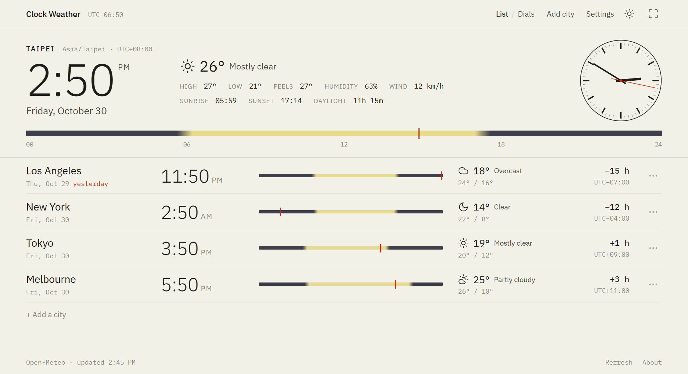
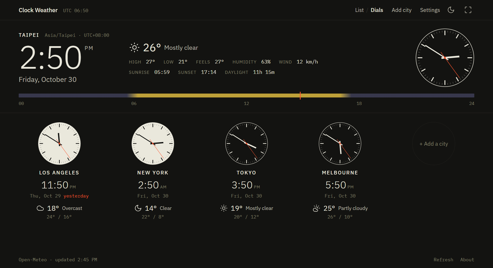

# Clock Weather

A world clock for Windows that also shows the current weather in every city.



Each city gets its local time, date (with *yesterday* / *tomorrow* when the date differs from
yours), hour difference, current weather with today's high and low, and a 24-hour bar showing
daylight and night from that city's real sunrise and sunset, with a marker at the current time.

The **Dials** view shows the same cities as a row of wall clocks. A dial turns inverted while it
is night in that city, so you can see at a glance who is probably asleep.



## Features

- Home city with large time, analog dial, full weather details and sunrise / sunset
- Any number of other cities: search by name (English or Chinese), reorder, remove, make home
- Weather, sunrise and sunset from [Open-Meteo](https://open-meteo.com/), refreshed every 10 minutes,
  cached for offline use. No account or API key needed
- List and Dials views
- Light, dark or follow-system theme
- English and 简体中文
- 12/24-hour time, optional seconds, °C/°F
- Keep the window on top, full screen with F11
- Remembers your cities, settings and window position

## Run from source

Needs [Node.js](https://nodejs.org/) 22.12 or newer.

```bash
npm install
npm start
```

> Electron 45 no longer downloads its binary during `npm install`. If `npm start` says Electron
> failed to install, run `npx install-electron` once and try again.

## Build

```bash
npm run dist            # unpacked app in dist/win-unpacked/ (run "Clock Weather.exe")
npm run dist:installer  # NSIS installer and portable .exe in dist/
```

## Project layout

| Path | What it is |
|---|---|
| `main.js` | Electron main process: window, saved window position, always-on-top |
| `preload.js` | The small bridge the page uses to talk to the main process |
| `src/index.html` | Page structure |
| `src/app.js` | Everything else: time zones, weather, rendering, settings |
| `src/styles.css` | Styles for both themes |

Times are computed with the built-in `Intl` time-zone database, so daylight-saving changes are
handled without any extra data.

## Credits

- Weather, sunrise/sunset and city search: [Open-Meteo](https://open-meteo.com/) (CC BY 4.0 data)
- Fonts: [IBM Plex Sans and IBM Plex Mono](https://github.com/IBM/plex) (SIL Open Font License 1.1),
  bundled through [Fontsource](https://fontsource.org/)
- Weather and interface icons are adapted from [Lucide](https://lucide.dev/)
  (ISC License, Copyright (c) for portions of Lucide are held by Cole Bemis 2013-2022 as part of
  Feather (MIT). All other copyright (c) for Lucide are held by Lucide Contributors 2022)
- Built with [Electron](https://www.electronjs.org/)

## License

[MIT](LICENSE)
